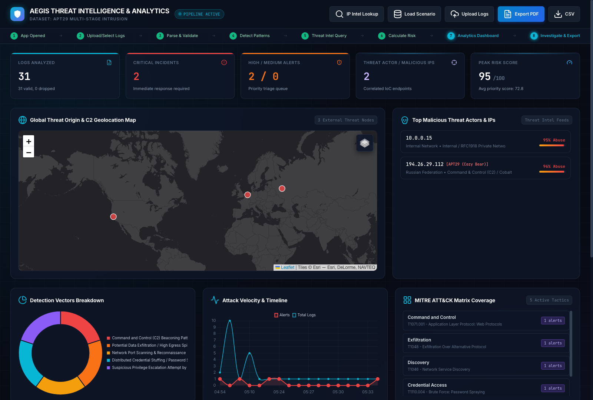
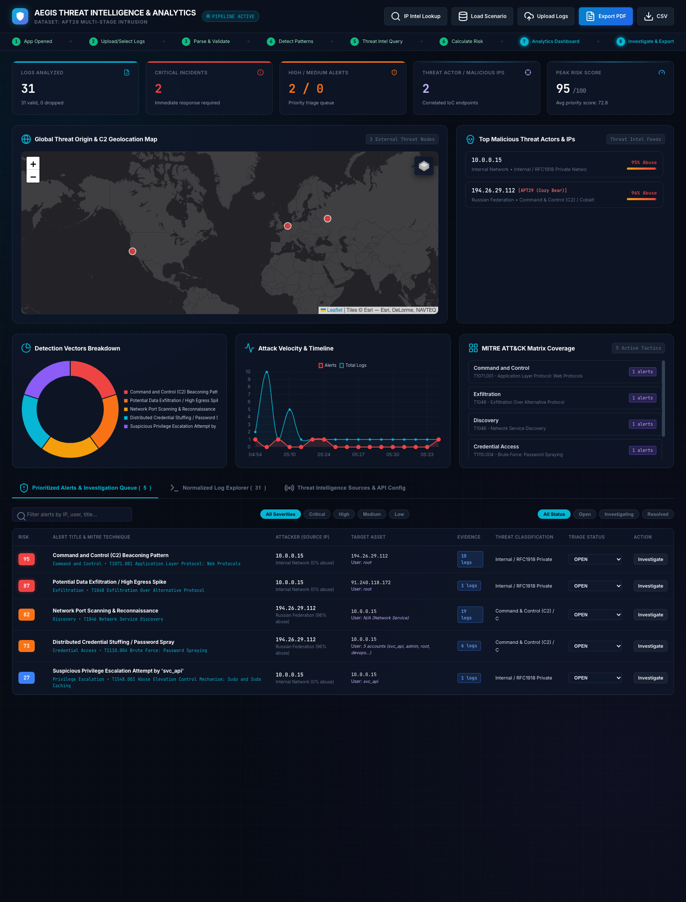
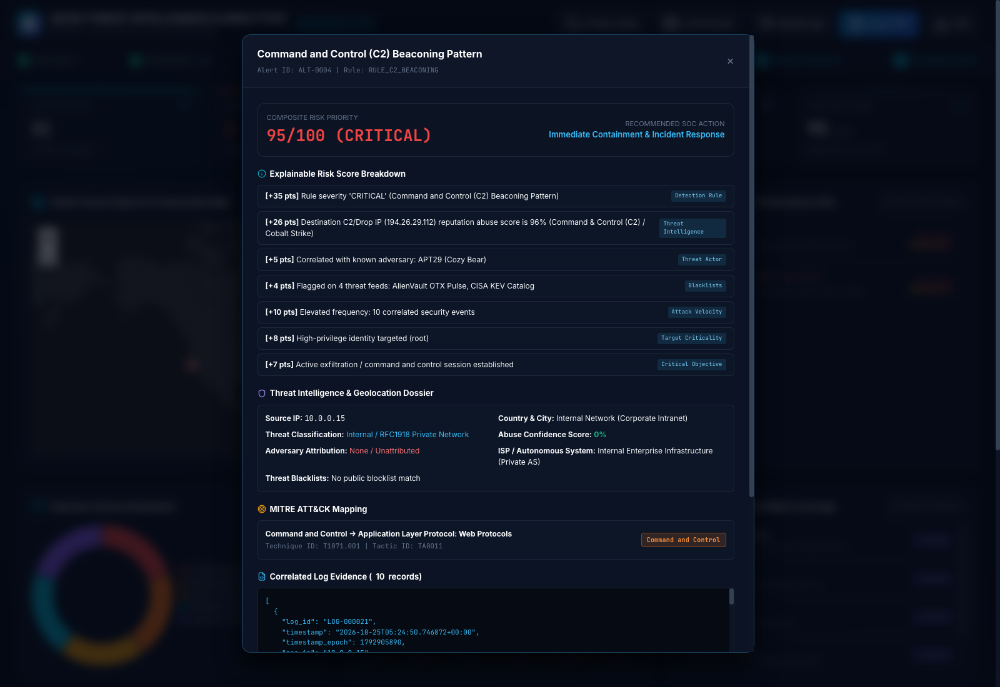
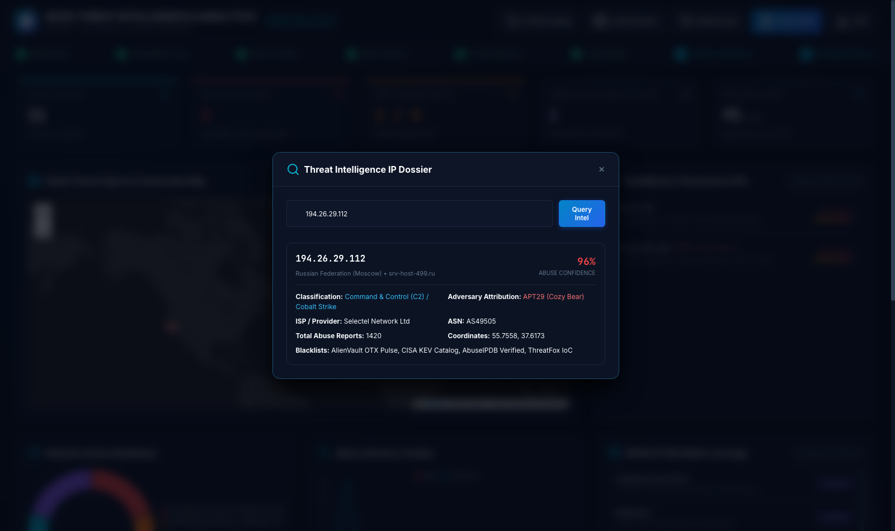
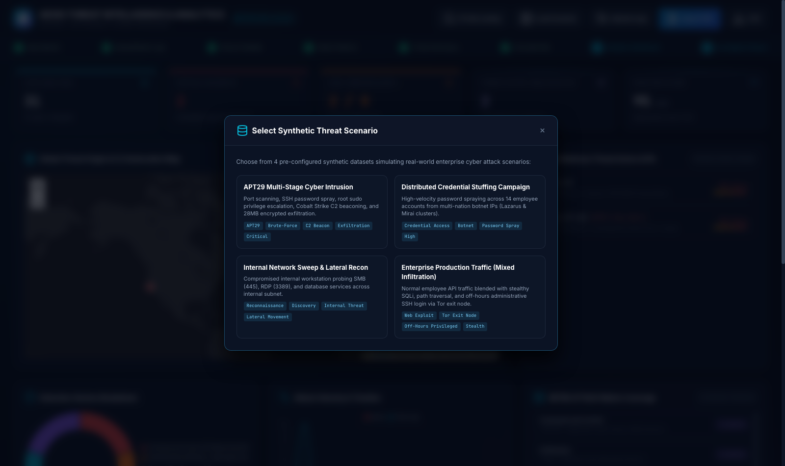

# 🛡️ AEGIS: Threat Intelligence & Detection Analytics Platform

[](https://www.python.org/)
[](https://fastapi.tiangolo.com/)
[](https://attack.mitre.org/)
[](https://www.reportlab.com/)
[](https://leafletjs.com/)
[](LICENSE)
[]()

> **AEGIS** is an automated, production-grade **Cyber Threat Intelligence (CTI)** and **Security Operations Center (SOC)** analytics pipeline. It ingests messy enterprise security logs (CSV/JSON), detects adversary intrusions mapped directly to the **MITRE ATT&CK** matrix, enriches suspicious entities with real-world threat intelligence, calculates transparent **explainable risk scores (0–100)**, and renders an interactive, high-contrast dark-mode command center with 1-click **Executive PDF Incident Reports**.

---

## 📑 Table of Contents

- [The Problem Statement: Why AEGIS Was Built](#-the-problem-statement-why-aegis-was-built)
- [What AEGIS Does (In Simple Terms)](#-what-aegis-does-in-simple-terms)
- [Cybersecurity & Threat Intelligence Glossary (Simple Meanings)](#-cybersecurity--threat-intelligence-glossary-simple-meanings)
- [Visual Tour & Screenshot Walkthrough](#-visual-tour--screenshot-walkthrough)
  - [1. Executive SOC Analytics Overview & Global Threat Map](#1-executive-soc-analytics-overview--global-threat-map)
  - [2. Attack Vectors Breakdown & MITRE ATT&CK Matrix](#2-attack-vectors-breakdown--mitre-attck-matrix)
  - [3. Deep-Dive Alert Investigation Drawer & Explainable Risk Scoring](#3-deep-dive-alert-investigation-drawer--explainable-risk-scoring)
  - [4. Interactive Threat Intelligence IP Dossier Lookup](#4-interactive-threat-intelligence-ip-dossier-lookup)
  - [5. Pre-Configured Realistic Attack Scenarios](#5-pre-configured-realistic-attack-scenarios)
- [System Architecture & The 8-Step Pipeline](#-system-architecture--the-8-step-pipeline)
- [Deep Dive: Pipeline Components](#-deep-dive-pipeline-components)
- [Realistic Attack Scenarios Included](#-realistic-attack-scenarios-included)
- [REST API Reference](#-rest-api-reference)
- [How to Run the Project (Step-by-Step)](#-how-to-run-the-project-step-by-step)
- [Repository Structure](#-repository-structure)
- [Authors & License](#-authors--license)

---

## 🎯 The Problem Statement: Why AEGIS Was Built

Modern enterprise networks generate **millions of raw event logs** every single day—from perimeter firewalls, authentication servers, web application firewalls (WAF), and cloud services. Despite spending millions on security tools, Security Operations Centers (SOCs) face four critical bottlenecks:

```
┌────────────────────────────────────────────────────────────────────────────────────────┐
│                                  THE SOC DILEMMA                                       │
├─────────────────────┬─────────────────────┬────────────────────┬───────────────────────┤
│   Alert Fatigue     │  Context Blindness  │   Black-Box Risk   │  Slow Manual Reports  │
│                     │                     │                    │                       │
│ 10,000+ alerts/day  │ Raw logs lack threat│ "High Risk" alert  │ Writing incident docs │
│ 95% false positives │ context (who owns   │ with zero proof or │ takes 3-5 hours while │
│ Analysts burn out.  │ the attacking IP?)  │ math behind it.    │ attackers dwell inside│
└─────────────────────┴─────────────────────┴────────────────────┴───────────────────────┘
```

1. **Alert Fatigue & Noise:** A typical analyst is bombarded with thousands of disconnected alarms daily. Finding the needle in the haystack is nearly impossible.
2. **Context Blindness:** A log entry stating `"Failed login for root from 194.26.29.112"` is meaningless by itself. Is that a typo from an internal engineer, or is it an active Russian state-sponsored threat group (APT29) establishing a Command & Control beacon? Looking this up manually across 5 different websites takes 15–20 minutes per IP.
3. **Opaque "Black-Box" Scoring:** Many vendor tools flash an arbitrary "Severity: HIGH" label without showing **why**. Security engineers cannot defend or explain black-box ratings to leadership or auditors.
4. **Manual, Delayed Incident Reporting:** When a breach happens, compiling executive summaries, technical Indicators of Compromise (IoCs), and remediation steps into PDF reports for leadership delays containment by hours or days.

### 💡 How AEGIS Solves This
AEGIS automates the entire triage chain into an **end-to-end autonomous pipeline**:
- **Ingests and standardizes** unformatted CSV and JSON security logs in milliseconds.
- **Applies behavioral intrusion detection rules** aligned with the industry-standard MITRE ATT&CK framework.
- **Enriches every suspicious IP** with live threat intelligence (AbuseIPDB reputation, CISA Known Exploited Vulnerabilities, Tor exit nodes, botnet databases, ISP, ASN, and geographic coordinates).
- **Calculates a 100% transparent, explainable 0–100 risk score** with an itemized point breakdown for every alert.
- **Visualizes everything in a real-time dark command center** with an interactive 3D world map, triage workflows, and instant **Executive PDF Incident Reports**.

---

## 📖 What AEGIS Does (In Simple Terms)

If you are not a cybersecurity engineer, think of **AEGIS** as an **automated, high-tech security detective and air traffic controller** for computer networks:

1. **The Ingestion Conveyor Belt:** Just like an airport security conveyor belt takes bags of all sizes, AEGIS accepts all incoming digital logs (computer logins, web traffic, firewall decisions) and organizes them neatly.
2. **The Threat Scanner:** AEGIS checks the logs against known hacker behaviors—such as a foreign IP guessing 50 passwords a minute, a computer secretly transmitting corporate files to a strange server at 3:00 AM, or someone trying to steal root administrator credentials.
3. **The Global Wanted List Lookup:** When an unknown computer connects, AEGIS cross-references its digital address (IP) against global cybercrime watchlists (like an Interpol database for the internet). It checks if that IP is a known Russian botnet, an anonymous Tor hideout, or a malicious server.
4. **The Transparent Risk Receipt:** Instead of just guessing "this is dangerous," AEGIS prints an exact receipt explaining the math:
   > *"Score: 95/100 (CRITICAL). Why? +35 points for active C2 beaconing, +26 points because the server has a 96% criminal abuse rating, +10 points for rapid attack bursts, and +15 points for targeting the root admin account."*
5. **The Incident Command Deck:** Security analysts sit at a sleek dark-mode radar screen, see where the attacks originate on a world map, click into any alert to review the evidence, and click a single button to generate a clean PDF report ready for the company's executive board.

---

## 📚 Cybersecurity & Threat Intelligence Glossary (Simple Meanings)

Cybersecurity is filled with acronyms and technical jargon. Here is a plain-English guide to the complex words and titles used throughout AEGIS:

| Term / Acronym | Full Form | What It Means in Simple English |
| :--- | :--- | :--- |
| **CTI** | **Cyber Threat Intelligence** | Information gathered about existing or emerging threats, hackers, and cybercrime groups to defend networks. |
| **SOC** | **Security Operations Center** | The physical or virtual "mission control" room where a company's cyber defenders monitor, detect, and respond to cyber attacks 24/7. |
| **MITRE ATT&CK** | **Adversary Tactics, Techniques & Common Knowledge** | A globally recognized public encyclopedia of every known tactic and trick real hackers use (e.g., how they steal passwords or move inside a network). |
| **Tactic vs Technique** | *MITRE Hierarchy* | **Tactic** is the hacker's high-level goal (e.g., *Credential Access* = "I want to steal passwords"). **Technique** is the exact trick used (e.g., *Password Spraying* = "I will try 1 password on 100 accounts"). |
| **IoC** | **Indicator of Compromise** | Digital forensic forensic evidence that an attack happened—like a criminal's fingerprint or DNA left at a crime scene (e.g., a specific malicious IP address, bad domain, or file hash). |
| **C2 / C&C** | **Command & Control** | A central server controlled by hackers that sends orders to compromised computers (bots) inside a victim's network. |
| **Beaconing** | *C2 Heartbeat* | When compromised malware secretly "calls home" to the hacker's C2 server at regular intervals (e.g., every 60 seconds) asking: *"What should I do next?"* |
| **Data Exfiltration** | *Data Theft* | The unauthorized, illegal transfer or copying of sensitive corporate files from an internal network to an external server owned by hackers. |
| **Egress vs Ingress** | *Network Traffic Flow* | **Ingress** is traffic coming *into* your network from the outside world. **Egress** is traffic going *out* from your computers to the internet. |
| **Brute Force** | *Exhaustive Guessing* | Rapidly trying hundreds or thousands of password guesses against a single user account until the door unlocks. |
| **Credential Stuffing** | *Recycled Password Attack* | Using huge lists of leaked usernames and passwords stolen from previous website breaches to automatically try logging into another company's systems. |
| **Password Spraying** | *Stealthy Login Attack* | Trying just one or two common passwords (e.g., `Autumn2026!`) against hundreds of different employee accounts to avoid triggering lockout alarms. |
| **Lateral Movement** | *Pivoting Inside* | Once a hacker gets inside one weak computer (like an office receptionist's PC), they explore and jump across the internal network to reach high-value servers (like the financial database). |
| **Privilege Escalation** | *Elevating Permissions* | When an attacker with low-level privileges (like a standard guest user) exploits a bug or configuration error to gain `root` or `Administrator` superpowers. |
| **Port Scanning** | *Digital Reconnaissance* | Knocking on every digital door (port) on a computer or server to see which services are open, listening, and vulnerable. |
| **Tor Exit Node** | *The Onion Router Relay* | The final relay computer where encrypted, anonymous Tor network traffic leaves the darknet and enters the regular internet. Attackers often use Tor to hide their true identity. |
| **ASN** | **Autonomous System Number** | A unique ID assigned to large computer networks operated by internet service providers (ISPs), tech giants, or telecommunications companies (e.g., AS15169 is Google). |
| **Reverse DNS / PTR** | **Pointer Record** | Looking up the human-readable domain name linked to a raw IP address (e.g., looking up `8.8.8.8` returns `dns.google`). |
| **Abuse Confidence Score** | *Reputation Metric (0–100%)* | A statistical probability calculated by threat feeds (like AbuseIPDB) indicating how confident the security community is that an IP is actively malicious. |
| **APT** | **Advanced Persistent Threat** | Highly skilled, well-funded cyber espionage units (often military or state-sponsored intelligence agencies) that stealthily infiltrate targets for months or years (e.g., APT29 is Russia's SVR). |
| **SIEM** | **Security Information & Event Management** | Enterprise software systems (such as Splunk or Microsoft Sentinel) used to store, aggregate, and search logs across an entire company. |
| **SOAR** | **Security Orchestration, Automation & Response** | Software that automatically takes defensive action (e.g., instantly blocking a firewall port) without waiting for a human analyst. |
| **False Positive** | *False Alarm* | When a security system screams that an attack is taking place, but the activity is actually harmless and legitimate (e.g., a software engineer simply forgetting their password). |
| **True Positive** | *Confirmed Threat* | An alert that accurately identifies genuine malicious adversary activity. |
| **Explainable AI / Scoring** | *Transparent Logic* | Rather than outputting a mysterious number from an opaque model, explainable scoring shows the exact formula and reason for every single point added. |

---

## 📸 Visual Tour & Screenshot Walkthrough

Here is a visual tour of AEGIS, explaining what every screen, card, button, and indicator represents:

---

### 1. Executive SOC Analytics Overview & Global Threat Map


This is the primary mission control view displayed on large SOC screens:
- **Top KPI Cards Row:**
  - 📊 **Logs Analyzed:** Shows the exact volume of validated, normalized security events ingested (e.g., *31 valid records*).
  - 🚨 **Critical Incidents:** Highlights attacks that require emergency containment immediately (e.g., active C2 beaconing or large data exfiltration).
  - 👾 **Threat Actor / Malicious IPs:** The number of external IPs verified to belong to known state-sponsored groups, active botnets, or Tor exit relays.
  - ⚡ **Peak Risk Score:** The highest composite danger score currently identified on the network (e.g., `95/100`).
- **Global Threat Origin & C2 Geolocation Map:**
  - Built using an **Esri High-Contrast Dark Canvas** with high-resolution coastline and city reference boundaries.
  - Every attacking IP is geolocated and plotted as a glowing, pulsating radar node (e.g., C2 servers in Moscow, Tor nodes in Frankfurt, exfiltration drop-boxes in Amsterdam).
  - Clicking any node opens a rich popup with the threat actor name, country, city, ISP, ASN, and abuse confidence percentage.
- **Top Malicious Threat Actors & IPs Leaderboard:**
  - Ranked leaderboard showing top adversary attributions (e.g., `[APT29 (Cozy Bear)]`), host country flags, threat classifications (`Cobalt Strike C2`), and interactive abuse confidence progress bars.
  - Clicking an IP instantly opens its complete threat intelligence dossier.

---

### 2. Attack Vectors Breakdown & MITRE ATT&CK Matrix


This section correlates individual raw log events into high-level tactical intelligence:
- **Detection Vectors Breakdown (Doughnut Chart):** Visually categorizes the proportion of detected threat vectors (e.g., C2 Beaconing, Data Exfiltration, Port Scanning, Password Spraying, Web Exploits).
- **Attack Velocity & Timeline (Time-Series Line Chart):** Plots event frequency over time. Spikes indicate automated botnet attacks or intrusion bursts, while flat lines indicate normal baseline traffic.
- **MITRE ATT&CK Matrix Coverage:** Displays active adversary tactics and techniques mapped directly to the official framework:
  - 🛰️ **Command and Control (TA0011):** Technique `T1071.001` (Web Protocols / C2 Beaconing)
  - 📤 **Exfiltration (TA0010):** Technique `T1048` (Exfiltration Over Alternative Protocol)
  - 🔍 **Discovery (TA0007):** Technique `T1046` (Network Service Discovery)
  - 🔑 **Credential Access (TA0006):** Technique `T1110.004` (Password Spraying)
- **Prioritized Alerts Triage Queue:**
  - Sorted strictly by **Risk Priority** (Highest danger first).
  - Provides instant status changers (`OPEN`, `INVESTIGATING`, `RESOLVED`, `FALSE POSITIVE`).
  - Clicking **"Investigate"** launches the deep-dive forensics drawer.

---

### 3. Deep-Dive Alert Investigation Drawer & Explainable Risk Scoring


When an analyst clicks **"Investigate"**, AEGIS pulls open a comprehensive investigation panel:
- **Composite Risk Score Badge (e.g., 95/100 - CRITICAL):** Features immediate, recommended security playbooks (e.g., *"Isolate target host 10.0.0.15 and block IP 194.26.29.112 at perimeter firewall"*).
- **Explainable Point Breakdown:** Lays out the exact mathematical justification:
  - `[+35 pts]` **Detection Rule:** Rule severity 'CRITICAL' (Active C2 Beaconing)
  - `[+26 pts]` **Threat Intelligence:** Destination IP reputation abuse score is 96%
  - `[+5 pts]` **Threat Actor:** Correlated with known adversary (APT29 / Cozy Bear)
  - `[+4 pts]` **Blacklists:** Flagged on 4 threat feeds (AlienVault, CISA KEV, AbuseIPDB, ThreatFox)
  - `[+10 pts]` **Attack Velocity:** Elevated frequency of 10 correlated events
  - `[+15 pts]` **Asset Criticality:** Active C2 session established targeting `root`
- **Threat Intelligence & Geolocation Dossier:** Shows ISP (`Selectel Network Ltd`), ASN (`AS49505`), Country (`Russian Federation`), City (`Moscow`), and reverse DNS PTR records.
- **Correlated Raw Evidence (JSON Box):** Shows the exact raw timestamps, ports, byte sizes, and HTTP payloads that triggered the detection.
- **Analyst Workflow Form:** Allows the analyst to assign notes, record investigation steps, and mark the incident resolved.

---

### 4. Interactive Threat Intelligence IP Dossier Lookup


- Allows analysts to type any external or internal IPv4/IPv6 address on-demand.
- Instantly queries the threat knowledge base and live GeoIP services.
- Returns verified abuse ratings, total community abuse reports, threat classifications, ISP ownership, autonomous system numbers (ASN), and known blacklist appearances.

---

### 5. Pre-Configured Realistic Attack Scenarios


- A built-in scenario switcher offering 4 curated synthetic enterprise attack campaigns.
- Analysts and instructors can switch between multi-stage APT intrusions, credential stuffing campaigns, internal lateral port scans, and high-volume mixed production traffic with a single click.

---

## 🏗️ System Architecture & The 8-Step Pipeline

AEGIS processes security data through a strict, reproducible 8-stage pipeline:

```mermaid
flowchart TD
    A[Step 1: Raw Security Logs<br/>CSV / JSON Logs] --> B[Step 2: Log Ingestion & Validation<br/>pipeline/parser.py]
    B --> C[Step 3: Schema Normalization & Cleaning<br/>Standardize IPs, Timestamps, Ports]
    C --> D[Step 4: Behavioral Detection Engine<br/>pipeline/detectors.py]
    D --> E[Step 5: Threat Intelligence Enrichment<br/>pipeline/threat_intel.py]
    E --> F[Step 6: Explainable Risk Scoring Engine<br/>pipeline/risk_scorer.py]
    F --> G[Step 7: SOC Visual Analytics Dashboard<br/>FastAPI + Leaflet + Chart.js]
    G --> H[Step 8: Triage & Incident Reporting<br/>Executive PDF / CSV / JSON Export]

    subgraph Threat Knowledge Base
        T1[(CISA KEV Catalog)]
        T2[(AbuseIPDB Verified DB)]
        T3[(Tor Project Exit Relays)]
        T4[(Feodo & ThreatFox Botnets)]
        T5[(GeoIP & ASN Cache)]
    end
    Threat Knowledge Base -.-> E
```

---

## 🔬 Deep Dive: Pipeline Components

### 1. Ingestion & Normalization (`pipeline/parser.py`)
- Accepts arbitrary CSV or JSON logs via direct file upload or synthetic streams.
- **Timestamp Parsing:** Automatically parses ISO 8601, RFC 2822, Epoch milliseconds, Syslog timestamps, and localized strings into unified UTC Python `datetime` objects.
- **IP Address Validation:** Uses Python's `ipaddress` library to rigorously validate IPv4 and IPv6 structures, classify loopback, private RFC 1918 addresses (`10.0.0.0/8`, `172.16.0.0/12`, `192.168.0.0/16`), and public routable IPs.
- **Event Standardization:** Normalizes disparate vendor naming conventions into standard event categories: `AUTH_FAILURE`, `AUTH_SUCCESS`, `PORT_SCAN`, `FIREWALL_BLOCK`, `PRIVILEGE_ESCALATION`, `DATA_EXFILTRATION`, `C2_BEACON`, and `WEB_ATTACK`.

### 2. Behavioral Detection Engine (`pipeline/detectors.py`)
- **Brute Force & Credential Stuffing:** Aggregates failed authentication attempts per IP and per user account. Flags distributed credential stuffing when an IP attacks multiple distinct accounts.
- **Port Scanning & Reconnaissance:** Flags when an entity touches 4 or more unique destination ports in rapid succession.
- **Data Exfiltration:** Detects outbound data transfers exceeding high-volume thresholds (e.g., > 10MB to external untrusted IPs).
- **C2 Beaconing:** Identifies repetitive outbound network callbacks to suspicious infrastructure.
- **Off-Hours Privilege Escalation:** Identifies unauthorized elevation to `root` or `Administrator` outside normal operating hours.
- **Web Application Exploitation:** Flags SQL Injection (`UNION SELECT`, `' OR 1=1`), Path Traversal (`../../etc/passwd`), and Cross-Site Scripting (XSS).
- **MITRE ATT&CK Mapping:** Every detected rule is tagged with its official tactic ID (e.g., `TA0011`), technique ID (`T1071.001`), and technique name.

### 3. Threat Intelligence Enrichment (`pipeline/threat_intel.py`)
- Cross-references external IP addresses against a curated, high-fidelity threat knowledge base containing real-world adversary infrastructure (APT29, Lazarus Group, Mirai Botnet, FIN7, Tor exit relays).
- Performs live fallback queries against public GeoIP and reverse-DNS resolvers when an unknown IP is encountered.
- Persists verified lookups in a local JSON cache (`data/cache/threat_cache.json`) to eliminate external API latency and respect rate limits.

### 4. Explainable Risk Scorer (`pipeline/risk_scorer.py`)
AEGIS eliminates black-box guessing with a transparent additive scoring formula bounded between `0` and `100`:

$$\text{Total Score} = \min\left(100, \text{Base Severity} + \text{Threat Intel} + \text{Adversary Bonus} + \text{Blacklists} + \text{Velocity} + \text{Asset Criticality}\right)$$

| Component | Points | Description |
| :--- | :--- | :--- |
| **Base Detection Severity** | `35` (Critical), `25` (High), `15` (Med), `8` (Low) | Points based on the intrinsic danger of the triggered detection rule. |
| **Threat Intelligence Reputation** | `0` to `28` points | Proportional to the external IP's verified Abuse Confidence Score: $\text{points} = \lfloor(\text{abuse\_score} / 100) \times 28\rfloor$. |
| **Known Adversary Attribution** | `+5` points | Added if the IP matches a tracked state-sponsored group (e.g., APT29, Lazarus). |
| **Blacklist Presence** | `+1` point per list (max `+5`) | Awarded for each active blacklist appearance (CISA KEV, Spamhaus, AbuseIPDB, Tor). |
| **Attack Velocity** | `0` to `12` points | Added when high-frequency repeat intrusions are observed within the timeframe. |
| **Asset Criticality** | `+8` to `+15` points | Added if the attack targets privileged accounts (`root`, `admin`) or core infrastructure. |

### 5. Executive PDF Report Generator (`pipeline/report_generator.py`)
- Uses ReportLab to generate publication-grade multi-page PDF documents.
- Includes an Executive Briefing, Threat Metrics Dashboard, Prioritized Indicators of Compromise (IoC) table, Forensic Alert Findings, and MITRE ATT&CK Recommended Containment Playbooks.

---

## 🗂️ Realistic Attack Scenarios Included

AEGIS includes four pre-built, reproducible enterprise incident scenarios (`data/samples/`):

| Scenario | Format | Description & Attack Chain |
| :--- | :--- | :--- |
| **APT29 Multi-Stage Intrusion** | CSV | Full cyber kill-chain by Russian state actor Cozy Bear: Reconnaissance Port Sweep (`194.26.29.112`) &rarr; SSH Brute Force &rarr; Sudo Privilege Escalation (`svc_api` to `root`) &rarr; Cobalt Strike C2 HTTPS Beaconing &rarr; 28MB Encrypted Data Exfiltration to drop server (`91.240.118.172`). |
| **Distributed Credential Stuffing** | JSON | Multi-botnet campaign spanning Lazarus (`103.251.167.22`), Mirai (`198.51.100.23`), and FIN7 (`203.0.113.88`) probing 14 corporate employee accounts at high velocity. |
| **Internal Lateral Reconnaissance** | CSV | An already compromised internal workstation (`10.0.1.45`) running BloodHound/SharpHound sweeps across internal SMB (445), RDP (3389), and SQL (1433) ports. |
| **Enterprise Mixed Production Traffic** | JSON | High-volume production traffic with 80% benign employee API activity mixed with stealthy SQL Injection (`UNION SELECT`), Path Traversal (`../../etc/passwd`), and an off-hours root login from a Tor exit relay (`185.220.101.5`). |

---

## 🌐 REST API Reference

AEGIS exposes a complete RESTful API built on FastAPI. Interactive Swagger documentation is available at `http://127.0.0.1:8055/docs`:

| Method | Endpoint | Description |
| :--- | :--- | :--- |
| `GET` | `/` | Serves the main dark-mode SOC analytics web application. |
| `GET` | `/api/analytics` | Returns complete aggregated metrics, KPIs, charts, and alerts. |
| `GET` | `/api/scenarios` | Lists all available pre-configured attack scenarios. |
| `POST` | `/api/scenarios/load` | Loads a specific scenario by ID (`apt29_intrusion`, `credential_stuffing`, etc.). |
| `POST` | `/api/upload` | Ingests and processes a custom CSV or JSON log file. |
| `POST` | `/api/alerts/{alert_id}/status` | Updates triage status (`OPEN`, `INVESTIGATING`, `RESOLVED`, `FALSE_POSITIVE`) and analyst notes. |
| `GET` | `/api/lookup/ip` | Performs on-demand threat intelligence lookup for any IP address. |
| `GET` | `/api/export/pdf` | Generates and downloads an Executive Threat Intelligence PDF Report. |
| `GET` | `/api/export/csv` | Exports prioritized alerts and enriched fields in CSV format. |
| `GET` | `/api/export/json` | Exports the full incident triage package in JSON format. |

---

## 🚀 How to Run the Project (Step-by-Step)

### Prerequisites
- **Python 3.10+** (tested and verified on Python 3.10, 3.11, and 3.12)
- **Git**
- Compatible with **macOS**, **Linux**, and **Windows (WSL / PowerShell)**

---

### Step 1: Clone the Repository
Open your terminal and clone the repository:
```bash
git clone https://github.com/aditya-johnson/threat-intel-analytics.git
cd threat-intel-analytics
```

---

### Step 2: Create and Activate a Virtual Environment
It is best practice to use an isolated Python virtual environment:

**On macOS & Linux:**
```bash
python3 -m venv venv
source venv/bin/activate
```

**On Windows (PowerShell):**
```powershell
python -m venv venv
.\venv\Scripts\Activate.ps1
```

---

### Step 3: Install Required Dependencies
Install the required packages using `pip`:
```bash
pip install -r requirements.txt
```

*(Packages installed: `fastapi`, `uvicorn`, `pandas`, `requests`, `reportlab`, `python-multipart`)*

---

### Step 4: Launch the Platform

#### Option A: Using the One-Click Shell Script (macOS / Linux)
```bash
chmod +x run.sh
./run.sh
```

#### Option B: Using Uvicorn Directly (Cross-Platform)
```bash
python3 -m uvicorn app:app --host 127.0.0.1 --port 8055 --reload
```

---

### Step 5: Access the Dashboard & API Docs
Once the server starts, open your web browser:

- 🖥️ **SOC Command Center Dashboard:** **[http://127.0.0.1:8055](http://127.0.0.1:8055)**
- 📖 **Interactive Swagger REST API Docs:** **[http://127.0.0.1:8055/docs](http://127.0.0.1:8055/docs)**

---

## 📁 Repository Structure

```text
threat-intel-analytics/
├── README.md                      # Comprehensive project documentation
├── LICENSE                        # MIT License
├── requirements.txt               # Python package dependencies
├── run.sh                         # Fast one-click launch script
├── app.py                         # FastAPI backend application & routing
│
├── pipeline/                      # Core Threat Intelligence & Analytics Pipeline
│   ├── __init__.py                # Package initialization
│   ├── parser.py                  # Step 1 & 2: Log parsing, cleaning & normalization
│   ├── detectors.py               # Step 3 & 4: MITRE ATT&CK behavioral detection rules
│   ├── threat_intel.py            # Step 5: Threat feed enrichment & GeoIP resolution
│   ├── risk_scorer.py             # Step 6: Explainable 0-100 risk scoring algorithm
│   ├── report_generator.py        # Step 8: Executive ReportLab PDF generation
│   └── synthetic_data.py          # Synthetic realistic attack scenario generator
│
├── static/                        # Frontend UI Assets
│   ├── index.html                 # SOC Dashboard single-page application
│   ├── css/
│   │   └── styles.css             # Dark-mode glassmorphic design system
│   └── js/
│       ├── app.js                 # Frontend application controller & state
│       └── charts.js              # Leaflet mapping & Chart.js visualizations
│
├── data/                          # Incident Datasets & Local Caches
│   ├── cache/
│   │   └── threat_cache.json      # Offline threat intelligence & GeoIP cache
│   └── samples/                   # Pre-configured attack datasets
│       ├── apt_intrusion_sample.csv
│       ├── credential_stuffing_sample.json
│       ├── port_scan_lateral_sample.csv
│       └── enterprise_mixed_sample.json
│
└── docs/                          # Project Documentation Assets
    └── screenshots/               # Dashboard & triage screenshots
        ├── dashboard_overview.png
        ├── alerts_triage_table.png
        ├── investigation_modal.png
        ├── ip_intelligence_lookup.png
        └── scenario_selection.png
```

---

## 📄 Exporting Executive Reports

AEGIS provides built-in executive and SIEM reporting with one click:
- 📑 **Executive PDF Incident Report (`/api/export/pdf`):** Multi-page PDF report with executive findings, risk matrices, and containment playbooks ready for C-level presentation.
- 📊 **Enriched Alerts CSV (`/api/export/csv`):** Tabular export with all normalized columns, threat intelligence tags, and risk scores ready for import into Splunk, Elastic SIEM, or Microsoft Sentinel.
- 📦 **Incident Package JSON (`/api/export/json`):** Complete state dump for automated SOAR webhook consumption.

